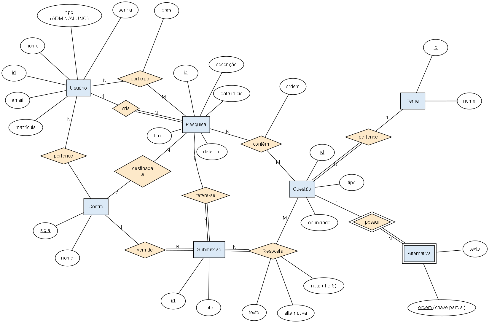

# Pesquisa de Satisfação do RU — UEL

Projeto da disciplina **Banco de Dados I** (UEL, 2026) — Prof. Dr. Anderson Paulo Avila Santos.

## Integrantes

- Ruan Magalhães
- Gabriel Soares

## Natureza do sistema

**Pesquisa de satisfação** do Restaurante Universitário (RU) da UEL.

A equipe do RU (administradores) cadastra questões, montadas em pesquisas, e escolhe quais centros da
UEL devem responder cada pesquisa. As questões são de escala de 1 a 5, múltipla escolha ou texto livre,
separadas por tema: Comida, Fila, Limpeza, Atendimento, Cardápio e Preço. Os alunos entram com login,
informando matrícula e centro, e respondem as pesquisas abertas para o seu centro.

## Particularidade

**Todas as respostas são anônimas.** O sistema guarda em lugares separados:

- `participacao`: **quem** já respondeu cada pesquisa, para ninguém responder duas vezes;
- `submissao` + `resposta`: **o que** foi respondido, sem nenhuma ligação com o aluno. Fica guardado
  apenas o centro, para os relatórios compararem grupos.

Ou seja: o sistema sabe que o aluno respondeu, mas não sabe o que ele respondeu.
Os relatórios comparam **temas**, **períodos** e **centros**.

## Requisitos atendidos

| Requisito | Onde está no sistema |
|---|---|
| RF1 – questões de pelo menos dois tipos | Questões de **escala (1 a 5)**, **múltipla escolha** (com alternativas) e **texto livre**, cada uma com um tema (menu *Questões*) |
| RF2 – avaliações com dados descritivos | Pesquisa com título, descrição e datas de abertura e fechamento (menu *Pesquisas*) |
| RF3 – montar a avaliação com questões cadastradas | Na nova pesquisa, o administrador marca as questões; a mesma questão pode estar em várias pesquisas |
| RF4 – indicar quem responde | Cada pesquisa é destinada a um ou mais **centros**; só os alunos desses centros a veem |
| RF5 – responder e registrar | O aluno entra, vê as pesquisas abertas para ele e responde; cada resposta é gravada |
| RF6 – particularidade | Anonimato: `participacao` separada de `submissao`/`resposta` |
| RF7 – relatórios com tabela e gráfico | 3 relatórios (seção [Relatórios](#relatórios)) |

## Tecnologias

- **Banco:** PostgreSQL 17.
- **Back-end:** Java com Spring Boot (só para os controllers e as telas). O banco é acessado por **JDBC puro**
  (`Connection`, `PreparedStatement`, `ResultSet`) nos DAOs escritos por nós. **Sem JPA/Hibernate.**
- **Telas:** JSP + JSTL e um CSS simples. Os gráficos de barras são feitos com HTML e CSS (a largura da
  barra é proporcional ao valor), **sem nenhuma biblioteca JavaScript**.

## Como rodar (passo a passo)

### 1. Instalar o que precisa

- **Java 21 ou mais novo** (JDK). Confira com `java -version`.
- **PostgreSQL 17**. O instalador oficial já traz o `psql` e o pgAdmin. Na instalação, use a senha
  `postgres` para o usuário `postgres`, ou troque a senha na classe `src/main/java/br/uel/ru/dao/Conexao.java`.
- Não precisa instalar o Maven: o projeto usa o `mvnw` (Maven Wrapper), que baixa tudo sozinho.

### 2. Criar o banco e carregar os dados

No terminal (PowerShell), dentro da pasta do projeto:

```powershell
$env:PGPASSWORD = "postgres"
$psql = "C:\Program Files\PostgreSQL\17\bin\psql.exe"

& $psql -U postgres -h localhost -c "CREATE DATABASE ru_uel ENCODING 'UTF8' TEMPLATE template0;"
& $psql -U postgres -h localhost -d ru_uel -f database/schema.sql
& $psql -U postgres -h localhost -d ru_uel -f database/carga.sql
```

Pelo **pgAdmin**: crie o banco `ru_uel`, abra o *Query Tool* nele e execute o `database/schema.sql`
e depois o `database/carga.sql`.

O `schema.sql` pode ser rodado de novo a qualquer momento: ele apaga as tabelas e cria tudo do zero.

### 3. Subir o sistema

```powershell
.\mvnw spring-boot:run
```

Quando aparecer `Started RuApplication`, abra **http://localhost:8080** no navegador.

### 4. Contas de teste (senha de todas: `123456`)

| Perfil | Email | Para quê |
|---|---|---|
| Administrador | `admin@uel.br` | cadastrar questões, pesquisas e administradores; ver relatórios |
| Aluno (CCE) | `ana.demo@uel.br` | ainda não respondeu nada: tem a pesquisa do jantar aberta para responder |
| Aluno (CCS) | `bruno.demo@uel.br` | o CCS não está na pesquisa do jantar: mostra que a pesquisa não aparece para ele |

Alunos novos se cadastram pelo link *Cadastre-se* da tela de login.

**Como criar um administrador:** entre como administrador e use *Painel → Novo administrador*. Essa tela
só abre para quem já é administrador; a tela de cadastro pública cria apenas alunos. O primeiro
administrador (`admin@uel.br`) vem pronto no `carga.sql`.

## Dados de teste (`carga.sql`)

Escritos à mão, com INSERTs normais:
- 9 centros e 5 temas;
- 22 usuários: 2 administradores e 20 alunos;
- 30 questões;
- 5 pesquisas: 4 semestrais (2024 a 2026) e uma aberta até 30/11/2026;
- 55 questionários respondidos.

As notas foram escolhidas para os relatórios mostrarem diferenças: a fila piora a cada semestre, a comida
melhora depois da troca de fornecedor e o CCS é o centro mais crítico.

## Organização do código (camadas)

```
database/        schema.sql, carga.sql, relatorios.sql
docs/            DER, esquema relacional, prints
src/main/java/br/uel/ru/
  controller/    recebem as requisições das telas e chamam os services e DAOs
  service/       regras e transações (gravações em mais de uma tabela)
  dao/           todo o SQL do sistema, com JDBC puro (Conexao abre a conexão)
  model/         classes simples (Questao, Pesquisa, Usuario...)
  config/        login: interceptor que protege as páginas /admin e /aluno
src/main/webapp/WEB-INF/jsp/   telas (JSP)
```

- A tela chama um **controller**, que usa um **service** e os **DAOs**, que falam com o banco.
  Não há SQL nos controllers nem nas telas.
- Gravações em mais de uma tabela rodam numa **transação**, escrita no próprio service:

```java
Connection con = Conexao.abrir();
try {
    con.setAutoCommit(false);   // começa a transação
    respostaDAO.inserirParticipacao(con, aluno.getId(), idPesquisa);
    int idSubmissao = respostaDAO.inserirSubmissao(con, idPesquisa, aluno.getSiglaCentro());
    for (Resposta r : respostas) {
        respostaDAO.inserirResposta(con, idSubmissao, r);
    }
    con.commit();               // grava tudo
} catch (SQLException e) {
    con.rollback();             // desfaz tudo
    throw e;
} finally {
    con.close();
}
```

  O mesmo padrão aparece no cadastro de questão (questão + alternativas) e de pesquisa
  (pesquisa + questões + centros).

## Modelo de dados

- DER (notação de Chen): [docs/DER.png](docs/DER.png)
- Esquema relacional, dependências funcionais e justificativa da 3FN: [docs/esquema.md](docs/esquema.md)


